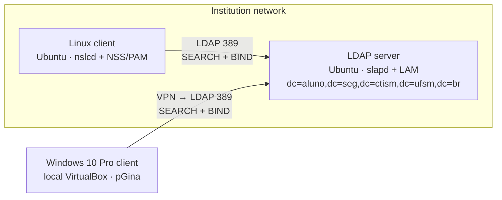

# LDAP Centralized Auth — Centralized authentication in a heterogeneous environment

[🇧🇷 Português](README.md) | 🇺🇸 English

Deployment of a **centralized LDAP authentication** infrastructure: an **OpenLDAP** server on Ubuntu, a **Linux client** integrated through NSS/PAM and a **Windows 10 client** integrated through **pGina**, with group-based access control and log analysis of every authentication step.

> Coursework for **Network Security** — Associate Degree (CST) in Computer Networks, Federal University of Santa Maria (UFSM), Colégio Técnico Industrial de Santa Maria. Prof. Tiago Rizzetti. 2026.

## Goals

- Set up an OpenLDAP server with a Directory Information Tree (DIT) containing organizational units, groups and users.
- Integrate a Linux client with the directory using NSS/PAM (`libnss-ldapd`, `libpam-ldapd`, `nslcd`).
- Enforce LDAP group-based access control: only the `gerencia` group gets `sudo`.
- Integrate a Windows 10 Pro client with the same directory using pGina (extra-credit task).
- Prove the authentication flow through server and client logs.

## Architecture



| Machine | Environment | Role |
|---|---|---|
| LDAP server | Ubuntu, VM on the institution's virtualization server | OpenLDAP (`slapd`), `ldap-utils` and LDAP Account Manager (LAM) |
| Linux client | Ubuntu, VM on the institution's virtualization server | Authentication through `nslcd` + NSS/PAM |
| Windows client | Windows 10 Pro, local VirtualBox, connected to the institution network over VPN | Authentication through pGina's LDAP plugin |

## Directory tree

```
dc=aluno,dc=seg,dc=ctism,dc=ufsm,dc=br
├── ou=People
│   ├── victor           (uidNumber 10000, group gerencia)
│   └── usuario          (uidNumber 10001, group usuarios)
└── ou=group
    ├── gerencia         → administrative privileges (sudo)
    └── usuarios         → restricted permissions
```

Users carry the `posixAccount` and `inetOrgPerson` object classes. The tree was built through the LAM web interface. (`gerencia` ≈ management, `usuarios` ≈ users.)

## Results

| Test | Result | Evidence |
|---|---|---|
| `victor` (gerencia) login on the Linux client + `sudo tcpdump` | ✅ Authenticated via LDAP, `sudo` allowed | [auth.log](docs/logs/auth.log) |
| First login of `usuario` (usuarios) on the Linux client | ✅ Authenticated via LDAP, `/home/usuario` created by `pam_mkhomedir` | [auth.log](docs/logs/auth.log) |
| `sudo tcpdump` as `usuario` | ✅ Blocked: `user NOT in sudoers` | [auth.log](docs/logs/auth.log) |
| SEARCH + BIND on the server | ✅ `nentries=1` and `err=0` on BIND (`mech=SIMPLE`) | [slapd.log](docs/logs/slapd.log) |
| `usuario` authentication on Windows (pGina simulation) | ✅ Authentication LDAP `True`, Local Machine `False` | [screenshot](docs/img/pgina-simulacao.png) |

A line-by-line reading of the logs is in [docs/en/log-analysis.md](docs/en/log-analysis.md).

## Limitations

- LDAP traffic uses port 389 **without TLS** (`ssf=0` in the logs): `SIMPLE` BIND in cleartext, acceptable only in a lab.
- The Windows client was validated through **pGina's Simulation tab**, not with a real login at the Windows logon screen.
- The directory tree was built in LAM, so there is no exported LDIF of it in this repository.

The report points to these production improvements: **LDAPS** (port 636), directory **replication** for high availability and **monitoring** with alerts on unauthorized access attempts.

## Documentation

- [Step-by-step configuration (server, Linux client and Windows client)](docs/en/configuration.md)
- [Log analysis](docs/en/log-analysis.md)

## Repository layout

```
ldap-centralized-auth/
├── server/
│   └── log_stats.ldif              # enables "stats" logging in slapd
├── linux-client/
│   ├── common-session.snippet      # pam_mkhomedir (/etc/pam.d/common-session)
│   └── sudoers.snippet             # sudo for the gerencia group
└── docs/
    ├── pt-br/                      # documentação em português
    ├── en/                         # documentation in English
    ├── logs/                       # slapd and auth.log excerpts
    └── img/                        # screenshots
```

> **Sanitization:** the original Base DN was replaced with `dc=aluno,...`, the test user was renamed to `usuario` / `Usuario Teste`, and internal IPs and hostnames were generalized (`<IP_CLIENTE>`, `ldap-server`, `ldap-client`).

## References

- [RFC 4511 — LDAP: The Protocol](https://www.rfc-editor.org/rfc/rfc4511)
- [OpenLDAP Software 2.6 Administrator's Guide](https://www.openldap.org/doc/admin26/)
- [pGina — Open Source Pluggable Logon System](http://pgina.org/)
- [Ubuntu Packages — libnss-ldapd / libpam-ldapd](https://packages.ubuntu.com/)

---

**Author:** Victor de Menezes — [LinkedIn](https://www.linkedin.com/in/victordmnzs/)
