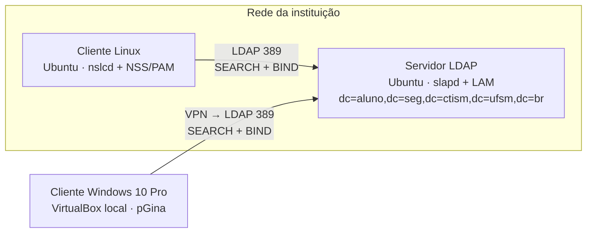

# LDAP Centralized Auth — Autenticação centralizada em ambiente heterogêneo

🇧🇷 Português | [🇺🇸 English](README.en.md)

Implantação de uma infraestrutura de **autenticação centralizada com LDAP**: servidor **OpenLDAP** em Ubuntu, **cliente Linux** integrado via NSS/PAM e **cliente Windows 10** integrado via **pGina**, com controle de acesso por grupo e análise dos logs de cada etapa da autenticação.

> Trabalho da disciplina de **Segurança de Redes** — CST em Redes de Computadores, Universidade Federal de Santa Maria (UFSM), Colégio Técnico Industrial de Santa Maria. Prof. Tiago Rizzetti. 2026.

## Objetivos

- Configurar um servidor OpenLDAP com uma árvore de diretório (DIT) contendo unidades organizacionais, grupos e usuários.
- Integrar um cliente Linux ao diretório usando NSS/PAM (`libnss-ldapd`, `libpam-ldapd`, `nslcd`).
- Aplicar controle de acesso baseado em grupo LDAP: só o grupo `gerencia` tem `sudo`.
- Integrar um cliente Windows 10 Pro ao mesmo diretório com o pGina (atividade de ponto extra).
- Comprovar o fluxo de autenticação pelos logs do servidor e do cliente.

## Arquitetura



| Máquina | Ambiente | Papel |
|---|---|---|
| Servidor LDAP | Ubuntu, VM no servidor de virtualização da instituição | OpenLDAP (`slapd`), `ldap-utils` e LDAP Account Manager (LAM) |
| Cliente Linux | Ubuntu, VM no servidor de virtualização da instituição | Autenticação via `nslcd` + NSS/PAM |
| Cliente Windows | Windows 10 Pro, VirtualBox local, ligado à rede da instituição por VPN | Autenticação via pGina com plugin LDAP |

## Estrutura do diretório

```
dc=aluno,dc=seg,dc=ctism,dc=ufsm,dc=br
├── ou=People
│   ├── victor           (uidNumber 10000, grupo gerencia)
│   └── usuario          (uidNumber 10001, grupo usuarios)
└── ou=group
    ├── gerencia         → privilégios administrativos (sudo)
    └── usuarios         → permissões restritas
```

Os usuários têm as object classes `posixAccount` e `inetOrgPerson`. A árvore foi criada pela interface web do LAM.

## Resultados

| Teste | Resultado | Evidência |
|---|---|---|
| Login de `victor` (gerencia) no cliente Linux + `sudo tcpdump` | ✅ Autenticado via LDAP, `sudo` permitido | [auth.log](docs/logs/auth.log) |
| Primeiro login de `usuario` (usuarios) no cliente Linux | ✅ Autenticado via LDAP, `/home/usuario` criado pelo `pam_mkhomedir` | [auth.log](docs/logs/auth.log) |
| `sudo tcpdump` com `usuario` | ✅ Bloqueado: `user NOT in sudoers` | [auth.log](docs/logs/auth.log) |
| SEARCH + BIND no servidor | ✅ `nentries=1` e `err=0` no BIND (`mech=SIMPLE`) | [slapd.log](docs/logs/slapd.log) |
| Autenticação de `usuario` no Windows (simulação do pGina) | ✅ Authentication LDAP `True`, Local Machine `False` | [print](docs/img/pgina-simulacao.png) |

A interpretação linha a linha dos logs está em [docs/pt-br/analise-de-logs.md](docs/pt-br/analise-de-logs.md).

## Limitações

- O tráfego LDAP usa a porta 389 **sem TLS** (`ssf=0` nos logs): BIND `SIMPLE` em texto claro, aceitável só em laboratório.
- O cliente Windows foi validado pela **aba Simulation do pGina**, não com um login real na tela do Windows.
- A árvore do diretório foi criada pelo LAM, então não há um LDIF exportado dela neste repositório.

O relatório aponta como melhorias para produção: **LDAPS** (porta 636), **replicação** do diretório para alta disponibilidade e **monitoramento** com alertas sobre tentativas de acesso não autorizado.

## Documentação

- [Configuração passo a passo (servidor, cliente Linux e cliente Windows)](docs/pt-br/configuracao.md)
- [Análise dos logs](docs/pt-br/analise-de-logs.md)

## Estrutura do repositório

```
ldap-centralized-auth/
├── server/
│   └── log_stats.ldif              # ativa o log "stats" no slapd
├── linux-client/
│   ├── common-session.snippet      # pam_mkhomedir (/etc/pam.d/common-session)
│   └── sudoers.snippet             # sudo para o grupo gerencia
└── docs/
    ├── pt-br/                      # documentação em português
    ├── en/                         # documentation in English
    ├── logs/                       # trechos dos logs do slapd e do auth.log
    └── img/                        # prints
```

> **Sanitização:** a Base DN original foi substituída por `dc=aluno,...`, o usuário de teste foi renomeado para `usuario` / `Usuario Teste`, e os IPs e hostnames internos foram generalizados (`<IP_CLIENTE>`, `ldap-server`, `ldap-client`).

## Referências

- [RFC 4511 — LDAP: The Protocol](https://www.rfc-editor.org/rfc/rfc4511)
- [OpenLDAP Software 2.6 Administrator's Guide](https://www.openldap.org/doc/admin26/)
- [pGina — Open Source Pluggable Logon System](http://pgina.org/)
- [Ubuntu Packages — libnss-ldapd / libpam-ldapd](https://packages.ubuntu.com/)

---

**Autor:** Victor de Menezes — [LinkedIn](https://www.linkedin.com/in/victordmnzs/)
