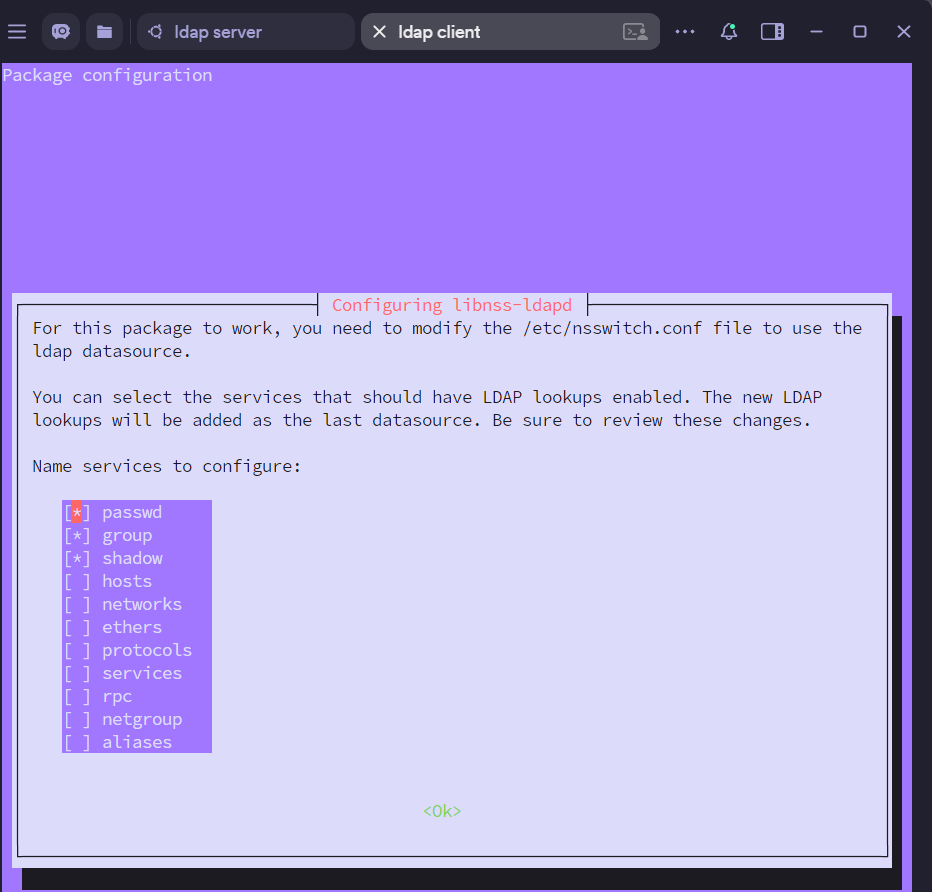
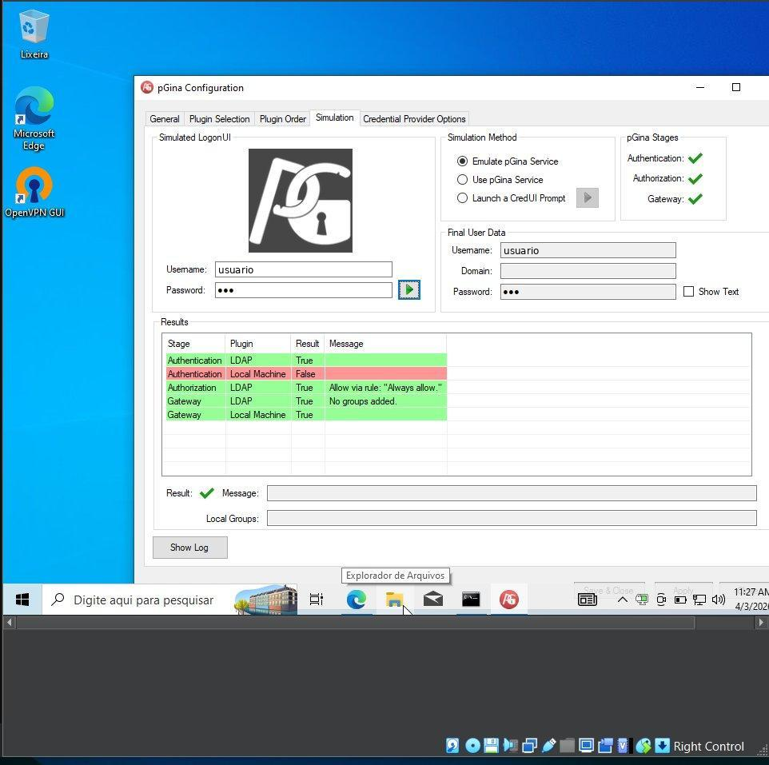

# Configuração passo a passo

[← Voltar ao README](../../README.md) · [English](../en/configuration.md)

Base DN usada em toda a infraestrutura: `dc=aluno,dc=seg,dc=ctism,dc=ufsm,dc=br`

---

## 1. Servidor LDAP (Ubuntu)

### 1.1 Instalação dos pacotes

OpenLDAP, ferramentas de linha de comando e a interface web LDAP Account Manager (LAM):

```bash
sudo apt install slapd ldap-utils ldap-account-manager
```

### 1.2 Domínio base

```bash
sudo dpkg-reconfigure slapd
```

No assistente foram informados o domínio DNS (`aluno.seg.ctism.ufsm.br`), que gera a Base DN acima, o nome da organização e a senha do administrador (`cn=admin`).

### 1.3 Estrutura do diretório (DIT) via LAM

A árvore foi criada pela interface web do LAM, acessada localmente no servidor:

1. Configuração dos sufixos das OUs `ou=People` e `ou=group`.
2. Criação dos grupos `gerencia` e `usuarios`.
3. Criação dos usuários, ambos com `posixAccount` e `inetOrgPerson`:
   - `victor`: uidNumber 10000, grupo `gerencia`
   - `usuario`: uidNumber 10001, grupo `usuarios`

### 1.4 Log no nível `stats`

Para que o `slapd` registre cada operação (CONNECT, SEARCH, BIND e seus resultados), o nível de log foi alterado com o LDIF [`server/log_stats.ldif`](../../server/log_stats.ldif):

```ldif
dn: cn=config
changetype: modify
replace: olcLogLevel
olcLogLevel: stats
```

```bash
sudo ldapmodify -Y EXTERNAL -H ldapi:/// -f log_stats.ldif
```

`-Y EXTERNAL -H ldapi:///` autentica pelo socket local do `slapd` usando a identidade do root do sistema, que é como se altera o `cn=config`.

---

## 2. Cliente Linux (Ubuntu)

### 2.1 Pacotes de integração

```bash
sudo apt install libnss-ldapd libpam-ldapd ldap-utils
```

### 2.2 NSLCD

O `nslcd` traduz as requisições do NSS e do PAM em consultas LDAP. No assistente foram informados o IP do servidor LDAP e a Base DN:

```bash
sudo dpkg-reconfigure nslcd
```

### 2.3 NSS

Habilita as bases `passwd`, `group` e `shadow` via LDAP no `/etc/nsswitch.conf`:

```bash
sudo dpkg-reconfigure libnss-ldapd
```



### 2.4 PAM: criação automática do home

Linha adicionada em `/etc/pam.d/common-session` ([`linux-client/common-session.snippet`](../../linux-client/common-session.snippet)):

```
session required pam_mkhomedir.so skel=/etc/skel umask=0022
```

### 2.5 Privilégios para o grupo `gerencia`

Linha adicionada ao sudoers com `sudo visudo` ([`linux-client/sudoers.snippet`](../../linux-client/sudoers.snippet)):

```
%gerencia ALL=(ALL:ALL) ALL
```

O `%` indica que `gerencia` é um grupo, resolvido pelo LDAP via NSS.

### 2.6 Testes

- **`victor` (gerencia):** login via LDAP com sucesso e `sudo tcpdump -i any -c 5` autorizado.
- **`usuario` (usuarios):** login via LDAP com sucesso, com `/home/usuario` criado automaticamente pelo PAM. O `sudo tcpdump -i any -c 5` foi bloqueado e o incidente ficou registrado.

Os logs desses testes estão em [análise de logs](analise-de-logs.md#2-cliente-linux--varlogauthlog).

---

## 3. Cliente Windows 10 Pro (ponto extra)

### 3.1 Ambiente

A VM Windows 10 Pro rodou localmente no VirtualBox, ligada à rede da instituição por VPN para alcançar o servidor OpenLDAP. Sem Active Directory, o Windows não autentica via LDAP nativamente. Por isso foi instalado o **pGina**, um Credential Provider open-source que substitui o componente de login nativo.

### 3.2 Plugin LDAP do pGina

O plugin LDAP foi habilitado na aba **Plugin Selection** com estes parâmetros:

| Parâmetro | Valor |
|---|---|
| Servidor LDAP | IP do servidor Ubuntu com o `slapd` |
| Porta | 389 |
| Base DN | `dc=aluno,dc=seg,dc=ctism,dc=ufsm,dc=br` |
| Modo de busca de DN | *Search for DN* ativado, filtro `(uid=%u)` |

Com isso, o pGina faz primeiro uma **busca anônima** pela entrada cujo `uid` é o nome digitado na tela de login e, ao achar o DN completo, faz o **BIND** com a senha informada.

### 3.3 Validação por simulação

O teste foi feito na aba **Simulation** do pGina, que emula o processo completo de autenticação sem alterar a sessão ativa. Foi usado o método *Emulate pGina Service* com as credenciais de `usuario`.



| Etapa | Plugin | Resultado | Significado |
|---|---|---|---|
| Authentication | LDAP | True | Entrada encontrada no diretório e credenciais validadas |
| Authentication | Local Machine | False | Esperado: não existe conta local com esse nome, então a autenticação foi resolvida inteiramente pelo LDAP |
| Authorization | LDAP | True | Política *Always allow* do pGina |
| Gateway | LDAP / Local Machine | True | Etapas de criação de sessão concluídas; num login real o Windows criaria o perfil local |

O resultado final (✅ ao lado de *Result*) confirma que todas as etapas foram concluídas.
